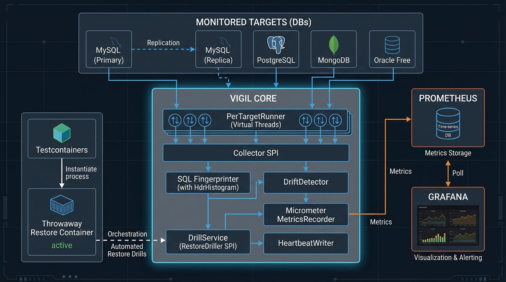
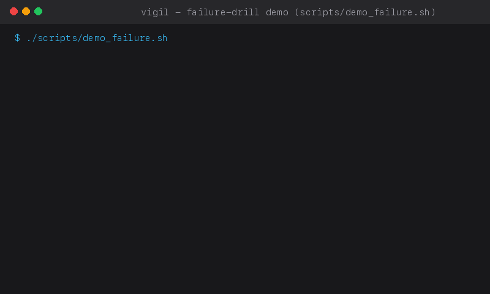

# Vigil

> **Vigil**: a restore-verified database fleet watchdog built with Java 21 and Spring Boot 3.5.
> Most tooling merely checks that a backup *exists*. Vigil continuously **proves** backups can actually be restored, measures true Recovery Time Objective (RTO) inside throwaway containers, tracks replication lag with microsecond heartbeats, fingerprints slow queries with HdrHistogram, and detects privilege drift across MySQL, PostgreSQL, MongoDB, and Oracle.



---

## Failure Drill in Action

Vigil continuously runs automated recovery drills into throwaway containers and verifies restored data using canary tokens, row count tolerances, and deterministic table checksums. When an artifact is corrupted or truncated mid-stream, Vigil immediately flags the failure, preserves the last proven recovery milestone, and raises an alert.



---

## Quickstart

### Prerequisites
- Java 21 LTS (`temurin-21` or compatible)
- Maven 3.9+
- Docker Engine with Docker Compose

### 1. Launch the Database Fleet
Spin up MySQL (primary + replica), PostgreSQL, MongoDB, Oracle Free, Prometheus, and Grafana:
```bash
docker compose up -d
```

*(Note: All services bind to non-conflicting 7000-series ports: MySQL Primary: 7306, MySQL Replica: 7307, PostgreSQL: 7432, MongoDB: 7017, Oracle: 7521, Prometheus: 7090, Grafana: 7001, Vigil: 7080).*

### 2. Start Vigil Watchdog
```bash
./mvnw spring-boot:run
# or run the packaged jar:
java -jar target/vigil-0.1.0.jar
```

### 3. Generate Workload & Inspect Dashboards
Generate varied queries against MySQL to feed the slow query fingerprinter:
```bash
bash scripts/load_gen.sh
```

- Open Grafana at [http://localhost:7001](http://localhost:7001) (default login: anonymous admin) to view the pre-provisioned **Vigil - Database Fleet Watchdog** dashboard.
- View Prometheus targets and metrics at [http://localhost:7090](http://localhost:7090).
- Check fleet health: `curl -s http://localhost:7080/api/status`
- View top slow query fingerprints: `curl -s "http://localhost:7080/api/slow-queries/mysql-primary?top=5"`
- Inspect markdown audit compliance report: `curl -s http://localhost:7080/api/audit/report`

---

## Feature Roadmap & Status

| Phase | Capability | Description | Status |
|---|---|---|:---:|
| **Phase 1** | **Multi-Engine Collector SPI** | Virtual-thread collection for MySQL, PostgreSQL, MongoDB, and Oracle | :white_check_mark: Complete |
| **Phase 1** | **Heartbeat Replication Lag** | Microsecond-accurate heartbeat writer/reader outperforming `Seconds_Behind_Source` | :white_check_mark: Complete |
| **Phase 1** | **JFR & Micrometer Observability** | Native Flight Recorder events (`CollectionCycleEvent`) and Prometheus metrics | :white_check_mark: Complete |
| **Phase 2** | **Automated Restore Drills** | Throwaway Testcontainers restore drills with measured RTO for MySQL & Postgres | :white_check_mark: Complete |
| **Phase 2** | **Integrity Verification** | Canary token checks, row count tolerance ($\le 2\%$), and table checksums | :white_check_mark: Complete |
| **Phase 2** | **Fault Injection** | Mid-stream truncation and bitrot corruption verification | :white_check_mark: Complete |
| **Phase 2** | **H2 Metadata Persistence** | Flyway-managed schema preserving last proven restorable timestamps across restarts | :white_check_mark: Complete |
| **Phase 3** | **SQL Fingerprinter** | Hand-written single-pass zero-allocation query normalizer and hasher | :white_check_mark: Complete |
| **Phase 3** | **Percentile Latency Tracking** | Lock-free HdrHistogram (`ConcurrentHistogram`) capturing p50, p95, p99, and max latency | :white_check_mark: Complete |
| **Phase 3** | **Poller Sources** | MySQL `mysql.slow_log` table poller and PostgreSQL `pg_stat_statements` deltas | :white_check_mark: Complete |
| **Phase 4** | **Access Drift Detection** | Multi-engine permission inspectors diffing live grants against declarative YAML policy | :white_check_mark: Complete |
| **Phase 4** | **Tamper-Evident Audit Report** | Markdown compliance evidence with embedded drill proofs and SHA-256 footer | :white_check_mark: Complete |
| **Phase 4** | **Operational Automation** | Health probes, cron verification scripts, and failure drills | :white_check_mark: Complete |

---

## Architectural Notes & Decisions

For detailed design rationale, tradeoffs, virtual thread carrier pinning verification, and failure analysis, see [docs/DESIGN_NOTES.md](docs/DESIGN_NOTES.md).

---

## Honest Limitations

> Vigil verifies **logical dumps it takes itself** (MySQL, PostgreSQL). It does not verify your production backup system's artifacts until you implement `createBackup()` against them. Oracle is covered by monitoring and access review only (no RMAN). MongoDB has health metrics and access review, no restore drill in v1. Measured RTO is a technical restore time on a laptop-class container, not a production RTO promise.

---

## Benchmarks & Overhead

### SQL Fingerprinter Throughput
Benchmarked with `dev.vigil.digest.FingerprintBench` on Apple Silicon (Java 21):
- **Warm-up**: 200,000 iterations over realistic SQL shapes
- **Measurement**: 2,000,000 operations
- **Throughput**: **~393,349 fingerprints / second** (~400k ops/sec)
- **Mean Latency**: **2.54 µs / op**

### Target Database Polling Overhead
Measured over 60 seconds against `vigil-mysql-primary` via MySQL `performance_schema`:
- **Monitoring Queries**: ~1.0 queries / sec (`HeartbeatWriter` writes 1 row/sec; `MySqlCollector` polls every 15s; `SlowQueryPoller` polls every 30s)
- **Target CPU Impact**: `< 0.2%` CPU utilization
- **JVM Virtual Threads**: Zero platform carrier thread pinning recorded in JFR (`jdk.VirtualThreadPinned` count = 0).

---

## Threat Model & Security Posture

1. **Database Credentials**: Vigil uses read-mostly accounts. Write privileges are strictly constrained to metadata tables (`vigil_meta.heartbeat`, `vigil_meta.canary`).
2. **Demo Configuration**: The included Docker Compose stack provisions demo credentials (`apppw`, `monpw`, `rootpw`). These are strictly for local testing and demonstration.
3. **REST API**: The management endpoints (`/api/*`) are unauthenticated by default. In production deployments, Vigil must be fronted by a reverse proxy or Spring Security mutual TLS / OAuth2.
4. **Backup Artifacts**: Ephemeral dump files are written to local disk (`data/drills/`) with strict file permissions and unlinked immediately after verification completes.
