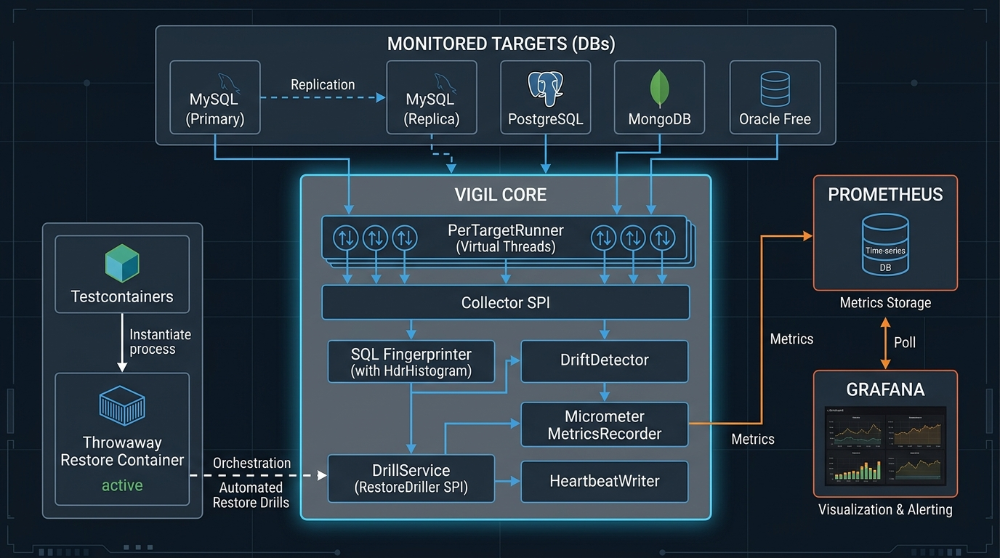
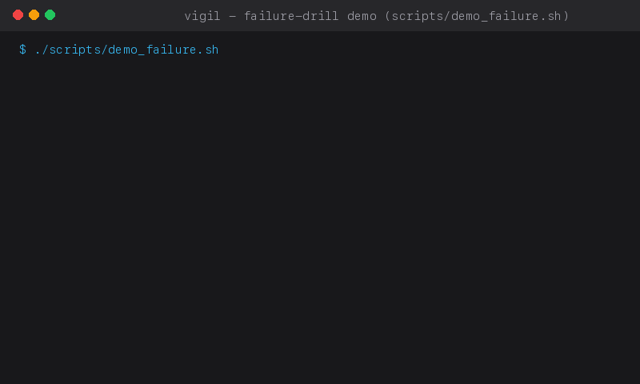

# Vigil

**A database fleet watchdog that proves backups are restorable.**

Vigil is a Java 21 / Spring Boot 3.5 service that monitors a fleet of MySQL, PostgreSQL,
MongoDB and Oracle databases. Most backup tooling only confirms that a backup file exists.
Vigil goes further: it regularly restores backups into throwaway containers, checks the
restored data, and records how long recovery took (RTO). It also measures replication lag
with heartbeats, groups slow queries by fingerprint, and flags database grants that drift
from a declared policy.



---

## Contents

- [Capabilities](#capabilities)
- [Engine support](#engine-support)
- [Getting started](#getting-started)
- [Configuration](#configuration)
- [REST API](#rest-api)
- [Observability](#observability)
- [Operational scripts](#operational-scripts)
- [Project layout](#project-layout)
- [Testing](#testing)
- [Performance](#performance)
- [Security considerations](#security-considerations)
- [Limitations](#limitations)
- [Design notes](#design-notes)

---

## Capabilities

### Automated restore drills
- Takes a logical dump (`mysqldump`, `pg_dump`) and restores it into a fresh
  [Testcontainers](https://testcontainers.com/) instance. The live database is never written to
  during a restore.
- Records each phase separately: container start, restore and verification. Their total is the
  measured RTO.
- Checks the restored data in several ways:
  - **Canary token.** A unique row is written just before the dump and must be present after
    the restore. This proves the backup is fresh and catches clean truncations.
  - **Row counts.** Counts for each table must match the source within a configurable
    tolerance (2% by default).
  - **Checksums.** Deterministic checksums of designated stable tables must match the source.
- **Fault injection.** Drills can deliberately corrupt the artifact (`TRUNCATE`, `BITROT`) to
  show that broken backups are detected.
- Drill history and the *last proven restorable* timestamp are stored in an embedded H2
  database managed by Flyway, so they survive restarts.

<p align="center"></p>

### Fleet health collection
- One small service provider interface (SPI) per capability: `Collector`, `SlowQuerySource`,
  `AccessInspector` and `RestoreDriller`. Each engine implements only what it actually
  supports.
- Each target is polled on its own virtual thread every cycle. An in-flight guard means a
  stalled database cannot delay or pile up work for healthy ones.
- Metrics are published through Micrometer to Prometheus. Collection cycles and restore drills
  are also emitted as custom JDK Flight Recorder events (`dev.vigil.CollectionCycle`,
  `dev.vigil.RestoreDrill`) for low-overhead profiling.

### Heartbeat replication lag
- `HeartbeatWriter` updates a timestamp on the MySQL primary every second (`NOW(6)`).
- `HeartbeatReader` compares that row against the replica's clock and reports lag in
  milliseconds with microsecond resolution.
- This avoids the known blind spots of `Seconds_Behind_Source`: it reads zero when replication
  is idle, `NULL` when replication breaks, and jumps in steps during long transactions.

### Slow query fingerprinting
- A hand-written, single-pass SQL normalizer removes literals, collapses `IN (...)` and
  multi-row `VALUES` lists, and hashes the resulting query shape.
- Latency for each fingerprint is tracked with a lock-free HdrHistogram
  (`ConcurrentHistogram`), which reports p50, p95, p99 and max.
- Sources: the MySQL `mysql.slow_log` table and PostgreSQL `pg_stat_statements`. For
  PostgreSQL, Vigil computes the change between polls.

### Privilege drift detection
- An inspector for each engine lists live users, roles and grants.
- `DriftDetector` compares them with a declarative YAML policy (`policy/grants-policy.yml`)
  and reports unexpected and missing grants, each with a severity level.
- Findings are included in a Markdown audit report. The report embeds recent drill evidence
  and ends with a SHA-256 integrity footer.

---

## Engine support

| Capability              | MySQL | PostgreSQL | MongoDB | Oracle |
|-------------------------|:-----:|:----------:|:-------:|:------:|
| Health metrics          |  Yes  |    Yes     |   Yes   |  Yes   |
| Heartbeat lag           |  Yes  |     —      |    —    |   —    |
| Slow query fingerprints |  Yes  |    Yes     |    —    |   —    |
| Privilege drift         |  Yes  |    Yes     |   Yes   |  Yes   |
| Restore drills          |  Yes  |    Yes     |    —    |   —    |

---

## Getting started

### Prerequisites
- Java 21 (Temurin or compatible)
- Maven 3.9+
- Docker Engine with Docker Compose

### 1. Start the demo fleet

```bash
docker compose up -d
```

This starts a MySQL primary and replica, PostgreSQL, MongoDB, Oracle Free, Prometheus and
Grafana. Every service uses a port in the 7000 range to avoid clashing with local installs:

| Service        | Port |
|----------------|------|
| MySQL primary  | 7306 |
| MySQL replica  | 7307 |
| PostgreSQL     | 7432 |
| MongoDB        | 7017 |
| Oracle Free    | 7521 |
| Prometheus     | 7090 |
| Grafana        | 7001 |
| Vigil          | 7080 |

### 2. Run Vigil

```bash
mvn spring-boot:run
```

Or build and run the packaged jar:

```bash
mvn package -DskipTests && java -jar target/vigil-0.1.0.jar
```

### 3. Generate workload and explore

```bash
bash scripts/load_gen.sh                                        # feed the slow query fingerprinter
curl -s http://localhost:7080/api/status                        # fleet health summary
curl -s -X POST http://localhost:7080/api/drills/mysql-primary  # run a restore drill now
```

Grafana at <http://localhost:7001> includes a pre-provisioned **Vigil – Database Fleet
Watchdog** dashboard.

---

## Configuration

All settings live in `src/main/resources/application.yml` under the `vigil` prefix.

| Property                          | Default                       | Description                                   |
|-----------------------------------|-------------------------------|-----------------------------------------------|
| `vigil.poll-interval`             | `15s`                         | Health collection interval                    |
| `vigil.collect-timeout`           | `10s`                         | Time limit for one target's collection        |
| `vigil.heartbeat-interval`        | `1s`                          | Heartbeat write interval on primaries         |
| `vigil.drill.cron`                | `0 0 */6 * * *`               | Restore drill schedule                        |
| `vigil.drill.work-dir`            | `./data/drills`               | Scratch space for dump artifacts              |
| `vigil.drill.row-count-tolerance` | `0.02`                        | Allowed row-count deviation after a restore   |
| `vigil.drill.canary-table`        | `vigil_meta.canary`           | Table used for canary tokens                  |
| `vigil.policy.file`               | `./policy/grants-policy.yml`  | Access policy used for drift detection        |
| `vigil.targets[]`                 | —                             | Managed databases (engine, role, URL, credentials, drill settings) |

Credentials are read from environment variables (`VIGIL_MYSQL_PW`, `VIGIL_PG_PW`,
`VIGIL_MONGO_PW`, `VIGIL_ORACLE_PW`). The demo defaults are for local use only.

---

## REST API

Base path: `http://localhost:7080/api`

| Method | Endpoint                            | Description                                                     |
|--------|-------------------------------------|-----------------------------------------------------------------|
| GET    | `/status`                           | Per-target status: up, heartbeat lag, last RTO, last proven restore |
| POST   | `/drills/{targetId}?corrupt=NONE`   | Run a restore drill now (`NONE`, `TRUNCATE`, `BITROT`)          |
| GET    | `/drills?targetId=…&limit=10`       | Drill history                                                   |
| GET    | `/slow-queries/{targetId}?top=10`   | Top fingerprints with latency percentiles                       |
| GET    | `/access/{targetId}/drift`          | Privilege drift findings (`refresh=true` forces a new scan)     |
| GET    | `/audit/report`                     | Markdown audit report with SHA-256 footer                       |

Spring Boot Actuator exposes `/actuator/health`, `/actuator/info` and `/actuator/prometheus`.

---

## Observability

- **Prometheus.** Scrapes `/actuator/prometheus`. Alerting rules are in
  `docker/prometheus/alerts.yml`.
- **Grafana.** The datasource and dashboard are provisioned from `docker/grafana/provisioning`.
- **JDK Flight Recorder.** Record the custom events with:

  ```bash
  java -XX:StartFlightRecording=filename=vigil.jfr,settings=profile -jar target/vigil-0.1.0.jar
  ```

---

## Operational scripts

| Script                     | Purpose                                                                  |
|----------------------------|--------------------------------------------------------------------------|
| `scripts/health_check.sh`  | Liveness probe for each container, including replica I/O and SQL threads |
| `scripts/backup_verify.py` | Exits non-zero if any target has no proven restore within N hours        |
| `scripts/vigil-cron.sh`    | Cron wrapper with locking (`flock`), logging and failure exit codes      |
| `scripts/demo_failure.sh`  | Compares a healthy drill with a truncated-artifact drill                 |
| `scripts/load_gen.sh`      | Generates varied slow queries against MySQL                              |

---

## Project layout

```
src/main/java/dev/vigil
├── spi/        Capability interfaces (Collector, SlowQuerySource, AccessInspector, RestoreDriller)
├── collect/    Scheduler, per-target runner, Micrometer recorder, JFR events
├── mysql/      MySQL collector, heartbeat, slow log source, access inspector, restore driller
├── postgres/   PostgreSQL collector, pg_stat_statements source, access inspector, restore driller
├── mongo/      MongoDB collector and access inspector
├── oracle/     Oracle collector and access inspector
├── drill/      Drill orchestration, verification, canary, fault injection, history repository
├── digest/     SQL fingerprinter, HdrHistogram stats, slow query poller
├── access/     Policy model, drift detector, audit service
├── audit/      Markdown audit report
├── api/        REST controller and error handling
├── config/     Typed properties and target registry
└── model/      Shared records and enums
```

---

## Testing

```bash
mvn test     # unit tests: fingerprinter, drift detector, grant parsing
mvn verify   # adds Testcontainers integration tests (requires Docker)
```

---

## Performance

**Fingerprinter throughput** (`dev.vigil.digest.FingerprintBench`, Apple Silicon, Java 21,
200k warm-up iterations, 2M measured operations):

- About 393,000 fingerprints per second
- 2.54 µs mean latency per operation

**Load on monitored databases** (measured over 60 s on the MySQL primary through
`performance_schema`):

- About 1 monitoring query per second (heartbeat every 1 s, collector every 15 s, slow log
  poller every 30 s)
- Under 0.2% CPU on the target
- No virtual-thread carrier pinning recorded by JFR (`jdk.VirtualThreadPinned` = 0)

---

## Security considerations

- **Least privilege.** Vigil connects with read-mostly accounts. Writes are limited to the
  metadata tables `vigil_meta.heartbeat` and `vigil_meta.canary`.
- **Demo credentials.** The Compose stack uses fixed demo passwords. Do not reuse them outside
  local testing.
- **API authentication.** The `/api/*` endpoints are unauthenticated. In production, put Vigil
  behind a reverse proxy or add Spring Security (mutual TLS or OAuth2).
- **Backup artifacts.** Dump files are written to the drill work directory with restrictive
  permissions and deleted after verification.

---

## Limitations

- Restore drills verify **logical dumps that Vigil takes itself** (MySQL and PostgreSQL).
  Verifying artifacts from an existing backup system requires implementing
  `RestoreDriller.createBackup()` for that source.
- Oracle and MongoDB support monitoring and access review only. There are no RMAN or
  `mongodump` drills yet.
- Measured RTO is the restore time on a container-sized dataset. It sets a lower bound and is
  not a production RTO guarantee.
- Point-in-time recovery (binlog/WAL replay) is not exercised.

---

## Design notes

Architecture decisions, trade-offs, the heartbeat rationale and what a restore drill can and
cannot prove are documented in [docs/DESIGN_NOTES.md](docs/DESIGN_NOTES.md).
